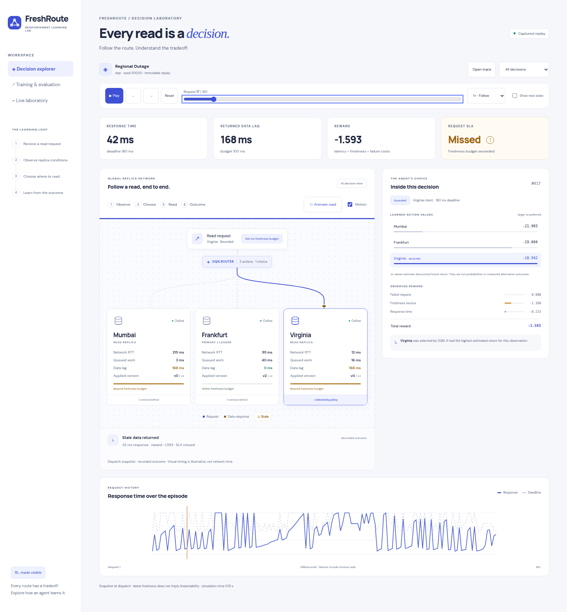
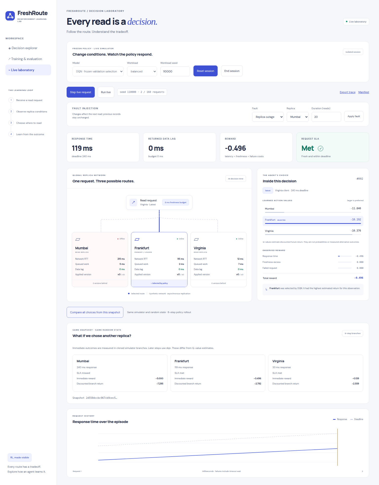

<div align="center">


# FreshRoute RL

**Learning where fresh reads should go.**

A reinforcement learning laboratory for staleness-aware read routing.<br>
Train an agent, watch it choose a replica, and inspect the cost of every decision.

<p>
  <code>Python</code> · <code>Q-learning + DQN</code> · <code>React + TypeScript</code> · <code>Motion mini</code>
</p>

[Quick start](#quick-start) · [Web laboratory](#web-laboratory) · [Results](#results) · [RL formulation](#rl-formulation) · [Documentation](#documentation)

</div>

---

## The problem

The nearest database replica can return stale data. The write leader may be fresh but slow or overloaded. **FreshRoute RL learns which replica should serve each read**, balancing response time, availability, and request-specific freshness requirements.

The GeoRead-RL idea runs in a seeded simulator with three replicas: **Mumbai**, **Frankfurt** (the write leader), and **Virginia**. Persistent queues and asynchronous replication give routing decisions consequences for future requests.

The project includes runnable source, trained Q-learning and DQN agents, a frozen evaluation study, and an interactive interface that explains actual model decisions. Nearest, leader-only, and random routing are comparison controls; the learned policies train directly from environment rewards.

## Web laboratory

<table>
  <tr>
    <th width="50%">Decision explorer</th>
    <th width="50%">Live laboratory</th>
  </tr>
  <tr>
    <td valign="top">
      <a href="docs/images/decision-explorer.png"></a>
    </td>
    <td valign="top">
      <a href="docs/images/live-laboratory.png"></a>
    </td>
  </tr>
</table>

*Click either screenshot to view it at full size.*

- **Follow a read.** Step through observation → choice → read → outcome. Inspect pre-action telemetry, all three learned action values, the selected route, and each reward term. Play, seek, filter, or import a JSONL replay.
- **Change the conditions.** Start an isolated session with a frozen policy, inject outages, replication lag, or workload pressure, and export the resulting trace. Compare all three first actions from an exact cloned simulator snapshot.
- **Inspect the evidence.** Explore raw training curves and the bundled model's test results. The evaluation panel identifies its model and split independently of any custom trace you open.

Routing animations use the lightweight [Motion mini engine](https://motion.dev/docs/animate). Explain, Follow, and Scan speeds make decisions easier to follow; pause controls and reduced-motion support keep playback accessible. Animation timing illustrates the sequence, while displayed latencies and rewards come from the simulator. Live sessions use frozen inference rather than online training.

See the [visualization guide](docs/visualization.md) for packet colors, failure behavior, and data sources, or follow the [five-minute demo guide](docs/demo-guide.md).

## Quick start

**Tested full stack:** Linux, Python 3.12, Node.js 24, and CPU PyTorch. No GPU, database server, cloud account, or external dataset is required.

Install [uv](https://docs.astral.sh/uv/getting-started/installation/) and Node.js, then run:

```bash
git clone https://github.com/1amKhush/freshroute-rl.git
cd freshroute-rl

uv venv .venv --python 3.12
uv pip install --python .venv/bin/python --torch-backend cpu --require-hashes -r requirements-rl.lock -r requirements-server.lock
npm --prefix web ci
node scripts/sync-demo.mjs
npm --prefix web run build
.venv/bin/python -m freshroute serve
```

Open **http://127.0.0.1:8000**. One Python server serves the built interface and inference API. Models, fonts, and replay assets are local; after installation, execution needs no external service.

<details>
<summary><strong>Use pip instead of uv</strong></summary>

From the repository root, create a Python 3.12 environment and install the same pinned, hashed dependencies:

```bash
python3.12 -m venv .venv
source .venv/bin/activate
python -m pip install --extra-index-url https://download.pytorch.org/whl/cpu --require-hashes -r requirements-rl.lock -r requirements-server.lock
```

Then follow the frontend setup and server commands above, starting with `npm --prefix web ci`.

</details>

<details>
<summary><strong>Run only the RL core — no web stack or third-party dependencies</strong></summary>

The original Q-learning demonstration runs with Python 3.11+ and the standard library:

```bash
python3 -m freshroute evaluate --model artifacts/demo/q-agent.json --episodes 8 --seed 100000
python3 -m freshroute trace --model artifacts/demo/q-agent.json --scenario regional-outage --seed 110000
python3 -m freshroute train --episodes 1200 --steps 160 --seed 7 --output artifacts/runs/my-q-agent.json
```

</details>

## Results

The preserved DQN study contains **14 trained models** and **700,000 training interactions**: five full-observation seeds and three seeds for each of three ablations, with 50,000 interactions per model.

The following results belong to the **validation-selected DQN**, evaluated on 30 held-out test episodes per scenario, with 160 requests per episode:

| Test scenario | Deadline + freshness met | Response availability | Mean reward |
| :--- | ---: | ---: | ---: |
| Balanced traffic | **82.7%** | 98.8% | −0.763 |
| Write burst | **52.3%** | 78.7% | −2.136 |
| Regional outage | **73.7%** | 88.3% | −1.280 |
| Traffic shift | **78.4%** | 98.3% | −0.860 |

Across **all five full-agent training seeds and all four scenarios**, macro SLA satisfaction is **71.0%**. Response availability means a reply within the request deadline. SLA satisfaction requires both that reply and an acceptable freshness lag.

These are synthetic simulator measurements under the configured workloads. The test uses new random seeds within the same regimes. The separate Q-learning demonstration is not a paired comparator in this DQN study.

[Full results, controls, ablations, and uncertainty](docs/report.md) · [Frozen model and test evidence](artifacts/releases/README.md)

## RL formulation

| Component | Definition |
| :--- | :--- |
| **Observation** | DQN receives 26 bounded telemetry features: client region, request class, freshness budget, deadline, and six features per replica. Q-learning uses a coarse state encoder. |
| **Action** | Choose one of three replicas: Mumbai, Frankfurt, or Virginia. |
| **Reward** | Penalize response time normalized by the deadline, excess freshness lag, and failed requests. Every cost term is recorded in the trace. |
| **Dynamics** | Each choice adds work to a persistent replica queue. Queue pressure changes later response times and follower replay. Episodes contain 160 reads across four workload scenarios. |
| **Algorithms** | Tabular Q-learning and Stable-Baselines3 DQN, trained through environment interaction. No supervised labels or heuristic search solution. |
| **Controls** | Nearest replica, leader-only, and random routing, evaluated separately from the learned agents. |

<details>
<summary><strong>Freshness budgets and interpretation</strong></summary>

| Request class | Timestamp-lag budget | Response deadline |
| :--- | ---: | ---: |
| Latest | 0 ms | 240 ms |
| Bounded | 100 ms | 180 ms |
| Relaxed | 500 ms | 140 ms |

Freshness is the latest committed write timestamp minus the replica's applied write timestamp at dispatch. A caught-up replica is fresh even if no write happened recently. Zero lag does not establish linearizability.

Observations aggregate simulator state and are partially observable. Q-values estimate discounted future returns; they are not probabilities. Counterfactual comparisons instead measure cloned simulator branches.

Reads use analytical admission-time snapshots. The simulator does not model mid-flight failures, automatic retries, leader election, or a quorum protocol.

</details>

The [methods report](docs/report.md) and [observation schema](docs/observation-schema.md) document the environment, learning setup, and feature definitions.

## Train and reproduce

After installing the full-stack dependencies, train a new DQN and inspect its behavior:

```bash
.venv/bin/python -m freshroute train-dqn --timesteps 50000 --seed 7 --output artifacts/runs/my-dqn
.venv/bin/python -m freshroute evaluate --model artifacts/runs/my-dqn --episodes 30 --seed 100100
.venv/bin/python -m freshroute trace --model artifacts/runs/my-dqn --scenario regional-outage --seed 110000
```

Use a new output directory for each DQN experiment. Checkpoints preserve configuration, schema, seeds, package versions, source fingerprints, and weights hashes. ZIP checkpoints use Python object serialization; load trusted local models.

<details>
<summary><strong>Reproduce the complete 14-model study</strong></summary>

```bash
PYTHONPATH=. .venv/bin/python scripts/run-experiments.py --output artifacts/runs/repeated-experiment
PYTHONPATH=. .venv/bin/python scripts/freeze-release.py --experiment artifacts/runs/repeated-experiment --output artifacts/runs/repeated-release
```

The checked-in study uses 50,000 interactions per model. Full observations use five independent training seeds; no-freshness, no-queue, and gamma-zero ablations use three each. Validation selects checkpoints and the demonstration model. Selection and all model hashes are frozen before final-test evaluation.

| Split | Seed range | Purpose |
| :--- | :--- | :--- |
| Training | Below 100,000 | Learn policy weights |
| Validation | 100,000–199,999 | Select checkpoints and the demonstration model |
| Final test | 200,000–299,999 | Evaluate frozen policies; the supplied study uses 200,000–200,029 |

Reports retain all model runs, per-episode metrics, request-class and region breakdowns, and descriptive bootstrap intervals across training seeds. Large reports use standard gzip-compressed JSON.

</details>

See [RL training](docs/rl-training.md) for configuration and checkpoint details.

## Development and checks

Run Python checks and compile the frontend:

```bash
.venv/bin/python -m unittest discover -s tests -v
npm --prefix web run build
```

With the Python server running in another terminal, run the browser checks:

```bash
LAB_URL=http://127.0.0.1:8000 npm --prefix web run test:e2e
```

Browser coverage includes replay accuracy, animated routing, pause and seek behavior, reduced motion, keyboard navigation, malformed uploads, mobile layout, live DQN sessions, faults, counterfactuals, and WCAG A/AA accessibility rules. Tests use Chrome at `/usr/bin/google-chrome`; set `CHROME_PATH` for another installation, or install Playwright Chromium. See the [verification record](docs/validation.md) for evidence and limits.

For frontend development, keep the Python server running and use `npm --prefix web run dev`. Vite proxies `/api` to port 8000. After changing demo or release artifacts, rerun `node scripts/sync-demo.mjs` and rebuild.

## Project structure

```text
freshroute-rl/
├── freshroute/              Simulator, learners, experiments, API, and CLI
├── web/                     React + TypeScript interface and browser checks
├── tests/                   Simulator, agent, API, fault, and release checks
├── configs/                 Versioned scenarios and experiment budget
├── scripts/                 Experiment, release, and asset preparation tools
├── artifacts/
│   ├── demo/                Trained Q-learning model and validation evidence
│   ├── experiments/         All 14 DQN runs and validation reports
│   ├── releases/            Frozen DQN, test evidence, and GUI replay
│   └── runs/                Ignored outputs from your own experiments
├── docs/                    Methods, demo guide, schemas, and screenshots
└── requirements-*.lock      Pinned, hashed Python dependencies
```

## Documentation

| Guide | What you will find |
| :--- | :--- |
| [Two-page report: PDF](docs/descriptive-report.pdf) · [LaTeX source](docs/descriptive-report.tex) | Submission report with the RL formulation and evaluation graphs |
| [Methods and results](docs/report.md) | Environment, algorithms, controls, ablations, and evaluation |
| [Demo guide](docs/demo-guide.md) | A five-minute walkthrough for presenting the project |
| [Visualization guide](docs/visualization.md) | Animation semantics, timing, accessibility, and data sources |
| [Web interface](docs/web-interface.md) | Replay, live sessions, API behavior, and counterfactuals |
| [Observation schema](docs/observation-schema.md) | Features, actions, rewards, and trace fields |
| [RL training](docs/rl-training.md) | Training configuration, model artifacts, and reproduction |
| [Verification record](docs/validation.md) | Executed checks, reproducibility evidence, and limitations |
| [Implementation plan](docs/implementation-plan.md) · [Commit record](docs/commit-plan.md) | Original project plan and development milestones |

The LaTeX report is self-contained: open it in Overleaf with pdfLaTeX; no image uploads are needed. The [commit record](docs/commit-plan.md) maps current snapshots to original source revisions and explains the reconstructed timeline. Optional history tools are documented in the [history editor guide](docs/edit-history.md) and [demonstration timeline guide](docs/reconstructed-timeline.md).

## Team

| Member | Roll number |
| :--- | :--- |
| Khushvendra Singh | B24CM1075 |
| Aditya Ranjan | B24CM1004 |

## References

[Q-learning paper](https://www.gatsby.ucl.ac.uk/~dayan/papers/cjch.pdf) · [Gymnasium environments](https://gymnasium.farama.org/introduction/create_custom_env/) · [Stable-Baselines3 DQN](https://stable-baselines3.readthedocs.io/en/master/modules/dqn.html) · [PostgreSQL asynchronous replication](https://www.postgresql.org/docs/current/warm-standby.html)

Reward weights, synthetic topology, workload calibration, and interface design are project choices.
