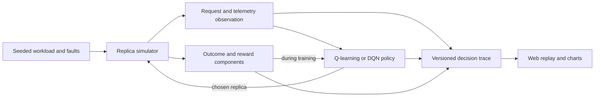

# FreshRoute RL implementation plan

> Execution update: the 16 structured implementation units now have real commits, including DQN, the web laboratory, live faults, counterfactuals, and a frozen test. This document preserves the original design plan below. Current scope, fixed 50,000-step-per-model study, evidence, and remaining extensions are recorded in [the report](report.md) and [commit record](commit-plan.md). Team/instructor approval remains a human step.

## 1. Target and present status

Build a reproducible RL laboratory answering:

> Can a learned read-routing policy improve the latency/freshness/availability tradeoff as replica conditions and request requirements change?

The deliverable is an actual learned agent plus runnable experiments and an explanatory web interface. The project must remain an RL project: the UI demonstrates the policy; it does not replace learning with rules.

**Implemented in the initial foundation:** seeded three-replica simulator, tabular Q-learning, train/evaluate/trace commands, tests, demonstration checkpoint, validation report, and decision trace. **Planned:** standard Gymnasium environment, DQN, broader statistical experiments, web replay and live controls, counterfactual explanations, and submission packaging. Completion of this document does not complete those milestones.

Assumptions: work begins locally without a GitHub remote; one simulated database shard; one leader and two followers; laptop CPU first; no private dataset; team size and submission date unknown. The schedule below uses relative weeks and must be adjusted to the actual deadline.

## 2. Practical scope and why RL fits

Request requirements differ. A feed read may tolerate hundreds of milliseconds of lag; an order status read may require the latest known commit. Client region, workload, replica queues, follower replay, and outages change over time.

Each routed read adds service work to one replica. Its queue changes future response latency and follower replay delay. Concentrating all reads on a currently attractive replica can hurt later requests. Therefore the environment has action-dependent transitions and a discounted sequential objective, rather than treating requests as independent labeled classification examples.

Initial scope:

- One write leader in Frankfurt; asynchronous followers in Mumbai and Virginia.
- Client requests from all three regions, three freshness/deadline classes, and three direct-read actions.
- Explicit simulated write commits, monotonically applied versions, queueing pressure, replication delays, and availability changes.
- Four workload scenarios: balanced, write burst, regional outage, traffic shift.
- CPU training, saved artifacts, frozen inference, and replayable decisions.

Defer multi-leader conflicts, leader election, arbitrary SQL execution, sharding, cross-shard transactions, and deployment to real geographic regions. A PostgreSQL experiment is an optional extension after the RL and GUI milestones work.

## 3. Environment and RL formulation

### Simulator state and observations

The internal process includes time, committed write timestamps, applied replica versions, queued service work, replica reachability, link delay, and current request. For the eventual standard environment, define all stochastic transitions and scenario phase explicitly; do not claim a complete MDP merely because the interface returns a vector.

| Observation group | Initial measurements | DQN extension |
| --- | --- | --- |
| Request | client region, SLA class, tolerance, deadline | request size and session minimum version |
| Network | per-replica region-dependent RTT | jitter/rolling RTT and heartbeat age |
| Workload | pending service work in ms | utilization and recent arrival/write rates |
| Replication | leader/applied versions, timestamp lag, link delay | bounded replay backlog/rate |
| Availability | current reachable flag | delayed heartbeat and failure evidence |

The initial Q-table encodes only region, SLA class, and three binary features per replica: online, queue >= 30 ms, and exceeds freshness tolerance. This is intentional state aggregation; it loses information and can alias different underlying states. It is an inspectable starting point, not a claim of optimal convergence in the simulator. Report unknown-state frequency and visits per action.

The DQN observation will use a fixed ordered, normalized vector or `Dict` of continuous features with declared bounds and no future outcomes. Fit any normalizer on training data only. For delayed telemetry experiments, document partial observability and compare stacking recent observations against current-only telemetry. Hidden actual freshness can be used to score an outcome, not secretly exposed to a realistic policy.

### Action space

**Initial and primary action space:** `Discrete(3)`, one direct read per replica. No fallback changes the agent's chosen destination. Unavailable selections or missed deadlines fail and are scored explicitly.

Only after the direct-read experiment is stable, consider `wait-for-catch-up-then-read` or a fixed two-replica hedge as additional discrete strategies. Each must specify deadline handling, additional replica work, cancellation, returned version selection, and consistency semantics. A hedge or majority reply is not automatically a strongly consistent read.

### Transition semantics

One decision handles one request. Snapshot freshness is measured at dispatch. Response time is analytically `RTT + queue work + service demand`, censored at the request deadline. Available requests consume service even if the caller times out; unreachable destinations admit no work.

Then advance a fixed 12 ms arrival interval: draw one policy-independent exogenous frame, update reachability, drain online queues and add background work, generate an optional leader write, advance follower replay without version regression, and generate the next request. Queue pressure also increases follower replication delay.

Simulation allows overlapping requests because responses may exceed the inter-arrival interval. It does not yet simulate in-flight events or mid-request outages. All constants are synthetic and must not be presented as measured geographic performance.

### Freshness and success definitions

```text
version_lag = latest_committed_version - applied_replica_version
staleness_ms = timestamp(latest_committed_version) - timestamp(applied_replica_version)
transport_ok = destination_reachable AND response_within_deadline
freshness_violation = transport_ok AND staleness_ms > request_tolerance_ms
sla_met = transport_ok AND NOT freshness_violation
```

A caught-up replica has zero staleness even when no write has occurred recently. Timestamp lag and version lag are distinct measurements and both should be displayed. The latest-at-dispatch budget is not a proof of linearizability, causal consistency, or read-your-writes. Session minimum versions require an explicit extension.

### Reward and objective

```text
latency_cost = w_latency * observed_response_ms / deadline_ms
excess = max(staleness_ms - tolerance_ms, 0)
freshness_cost = w_freshness * min(excess / max(tolerance_ms, 50), 2)
failure_cost = w_failure * indicator(unavailable OR timeout)
reward = -(latency_cost + freshness_cost + failure_cost)
objective = maximize E[sum_t gamma^t * reward_t]
```

Initial weights: `w_latency=1`, `w_freshness=2`, `w_failure=4`; discount `gamma=0.95`. Failed requests get zero freshness cost and an explicit failure cost. Missing data never becomes a freshness success. Log each component, not just the scalar reward.

A weighted penalty does not enforce a hard freshness bound. If hard guarantees are later required, model a freshness eligibility constraint or fail the request explicitly and report the mechanism separately. Do not relabel a soft penalty as a correctness guarantee.

The fixed episode horizon is a truncation of a continuing process, so bootstrapping continues at truncation. True terminal states, if added later, disable bootstrapping. Compare `gamma=0` against `gamma=0.95` to establish whether future queue effects help this particular task.

## 4. Learning implementation

### A. Inspectable foundation: tabular Q-learning

Implemented update:

```text
Q(s,a) <- Q(s,a) + alpha * (reward + gamma * max_a' Q(s',a') - Q(s,a))
```

Use epsilon-greedy exploration, epsilon decay from 1.0 to 0.05, initial alpha 0.12, zero initial values, seeded action tie breaking during training, and deterministic lowest-index ties for evaluation. Save Q-values, visitation counts, encoder version, reward configuration, source hash, training seeds, and training curve as JSON. There is no heuristic policy warm start or supervised target dataset.

### B. Main experiment: DQN

Use a Gymnasium wrapper and Stable-Baselines3 DQN with `MlpPolicy` for a flat vector or `MultiInputPolicy` for `Dict` observations. Start with a two-layer 128-unit MLP, 100k replay capacity, batch 64, learning rate 1e-4, gamma 0.95, 5k warm-up steps, target update every 1k steps, and 250k interactions. These are trial settings to validate, not tuned results. Estimate CPU cost with a 10k-step run first.

Use replay, target network updates, epsilon exploration, evaluation callbacks, saved normalizer state where relevant, and best-validation checkpoint selection. Record package versions and hardware. Pin tested dependencies with a lockfile in this milestone.

The library's standard implementation is vanilla DQN. Do not claim Double DQN, Dueling DQN, or prioritized replay unless actually implemented and independently validated. PPO is optional only if there is time for a clearly motivated RL comparison; it is not required for the core submission.

## 5. Architecture and repository growth



Current modules: `environment.py`, `agent.py`, `experiments.py`, `__main__.py`. Planned additions:

```text
freshroute/gym_env.py       Gymnasium adapter and normalized observations
freshroute/dqn.py           training/inference adapter; no UI dependency
freshroute/scenarios.py     versioned scenario configuration and fault schedules
freshroute/api.py           local FastAPI replay and live-session endpoints
web/                       React + TypeScript + Vite decision explorer
configs/                   validated environment/reward/experiment configurations
artifacts/releases/        selected final models, evaluation, manifests
docs/report.md             methods, results, limitations, reproduction
```

Keep the simulator independent from the web server. The API delegates to the same environment/policy code used by the CLI. Start the UI by loading static trace files; add live sessions after trace replay works. Background training should run as a separate command/process, not inside a blocking request handler.

## 6. Evaluation protocol

### Controls and splits

The submitted solution is the learned RL policy. Nearest, leader-only, and random routing are labeled evaluation controls; none generates labels or acts as a hidden production fallback. They are not heuristic search implementations.

Reserve seed ranges now:

| Purpose | Range | Use |
| --- | --- | --- |
| Training | 0 through 99,999 | environment interaction and learning |
| Validation/development | 100,000 through 199,999 | choose settings, checkpoints, and GUI traces |
| Final test | 200,000 through 299,999 | locked configuration and final report only |

Initial CLI training/validation commands enforce their respective ranges. The final test command and experiment matrix are not implemented yet. Initial seeds separate random streams, but they do not prove out-of-distribution generalization. Add separately configured held-out lag/load/failure regimes before making robustness claims.

For each compared policy, reuse exogenous workload seeds and draw schedules, but let its own queues and replication consequences evolve independently. Never force identical endogenous queue traces. The initial simulator test checks that action changes do not shift the exogenous RNG stream.

For the final run: five independent training seeds (or at least three if compute limits are recorded), 30 evaluation episodes per scenario per trained model, frozen model/encoder/normalizer, epsilon zero, and no updates during evaluation. Pick hyperparameters on validation only, then freeze the test matrix. Report per-training-seed summaries and an interval across independent training runs; do not treat thousands of dependent requests as independent samples.

### Metrics

- Mean episode return and mean per-request reward, with all reward components.
- Mean and p50/p95/p99 successful response time, plus failure-inclusive response-time distribution so fast failures cannot appear to win.
- Response availability, timeout rate, unavailable-destination rate, and joint SLA satisfaction.
- Freshness violation rate among successful responses, with denominators and sample counts; timestamp and version lag distributions.
- Replica route share, queue pressure, regional and request-class breakdowns, and unseen-state frequency for the Q-table.
- Learning curves, wall time, transitions, model size, and seeded reproducibility.

The current evaluator implements mean response time including failures, successful-response p95, availability, SLA rate, freshness violation rate, mean timestamp lag, failure types, route counts, and unknown states, with per-episode metrics. Other percentiles, confidence intervals, breakdowns, and multi-training-seed aggregation remain planned.

### Ablations and honest success criteria

Compare full observations against no-freshness and no-queue observations; compare gamma zero against the sequential objective; repeat with reduced and increased freshness penalties. Every observation/reward ablation trains a new agent. A GUI weight slider alone is not an ablation.

The minimum success is a reproducible learned policy, validated simulator, and clear evaluation of tradeoffs. A desirable result is better joint SLA or return than fixed controls across several regimes without hiding regression in availability or freshness. Do not promise a numerical improvement before measuring it. If RL loses, investigate representation/transition/reward choices, report it, and preserve the evidence.

## 7. Milestones and acceptance gates

| Stage | Work | Done when | Dependencies |
| --- | --- | --- | --- |
| M0: proposal and plan | name, idea, scope, team assignments, commit plan | proposal reviewed by team; remaining instructor fields filled | none |
| M1: runnable RL foundation | simulator, Q-learning, CLI, provenance, tests | seeded run reproduces; queues depend on actions; save/load/frozen replay pass | M0 |
| M2: environment qualification | scenario configs, bounded vector observations, Gymnasium adapter | environment checker and invariants pass; no future telemetry leakage | M1 |
| M3: DQN experiment | locked dependencies, CPU trial, replay/target training, checkpoint loading | at least one real training run and repeatable inference; curve and provenance saved | M2 |
| M4: experiment evidence | multiple training seeds, paired scenarios, ablations, uncertainty | full metrics and raw episodes available; validation and test isolated | M3 |
| M5: web replay explorer | topology, replay, decision/action values, reward charts, controls | all views render actual trace values; keyboard and narrow screen work | M1 trace schema |
| M6: live laboratory | local API, session stepping, scripted faults, comparison, counterfactuals | live and CLI seeded traces agree; sessions remain isolated | M3, M5 |
| M7: submission | final model, clean setup, report, video/demo script, repository | fresh setup runs exact README commands; artifact hashes verify; final test recorded | M4, M6 |

Present status: M1 has its initial implementation; M0 team/instructor review and M1 broader qualification remain team work. M2 onward are planned. A demonstration checkpoint is not the final trained DQN agent.

Suggested six-week allocation: week 1 M0/M1; week 2 M2; week 3 M3 and start M5; week 4 M4/M5; week 5 M6; week 6 M7. Team work can run simulator/RL, evaluation, and UI tracks concurrently after agreeing on the trace contract. Assign actual contributors based on team membership; do not invent attribution.

## 8. GUI delivery

Build a **decision laboratory**, with topology on the left and a selected-request inspector on the right. Include a separate training/evaluation view. First implement saved replay; then integrate live inference. See [the web interface specification](web-interface.md) for screen layout, interactions, accessibility, and endpoint contracts.

The GUI should answer: What did the agent observe? Which action had the highest estimated return? What did it choose? What was the measured outcome? Which cost dominated? What changed after the action? Q-values are estimated discounted returns, not confidence probabilities or a verbal proof of reasoning.

## 9. High-value extensions

Prioritize **snapshot counterfactual replay**: clone an exact simulator state plus RNG state, branch across all actions, and compare immediate and multi-step outcomes with explicit rollout assumptions. This can explain surprising choices without a language model inventing reasons. Store branches with snapshot/model hashes and keep them out of training unless an experiment explicitly says otherwise.

Next consider session minimum-version requirements and delayed telemetry. A final optional extension is a local PostgreSQL leader/follower setup with controlled network impairment and an instrumented versioned key-value workload. Verify observed freshness against actual committed versions, distinguish synthetic delay from geographic latency, and keep simulator evidence separate. Avoid over-scoping into a full database implementation.

## 10. Verification and final checklist

Initial checks:

```bash
python3 -m unittest discover -s tests -v
python3 -m freshroute train --episodes 1200 --steps 160 --seed 7 --scenario mixed --output artifacts/runs/q-agent.json
python3 -m freshroute evaluate --model artifacts/runs/q-agent.json --episodes 8 --seed 100000 --output artifacts/runs/evaluation.json
python3 -m freshroute trace --model artifacts/runs/q-agent.json --scenario regional-outage --seed 110000 --output artifacts/runs/decisions.jsonl
```

Later gates add the Gymnasium checker, DQN checkpoint replay, API/CLI equivalence, frontend build and browser interaction checks, and a clean-environment reproduction. Use tests for simulator and learning correctness; do not mistake a successful frontend build for successful training.

- [x] Formulate an RL task and create a runnable initial learner.
- [x] Document installation, execution, source/seed provenance, and limitations.
- [x] Provide an initial trained checkpoint, validation report, and decision trace.
- [ ] Add approved team details and actual GitHub remote/link.
- [ ] Maintain real incremental commits and contributor attribution.
- [ ] Implement the standard environment and train the main DQN agent.
- [ ] Complete multiple-seed evaluation, ablations, and frozen final test.
- [ ] Implement the web interface with truthful decision explanations.
- [ ] Deliver final model, dependency lock, report, demo script/video, and clean setup evidence.

## References used in this plan

- [Watkins and Dayan (1992), Q-learning](https://www.gatsby.ucl.ac.uk/~dayan/papers/cjch.pdf).
- [Gymnasium custom environments](https://gymnasium.farama.org/introduction/create_custom_env/) and [termination versus truncation](https://farama.org/Gymnasium-Terminated-Truncated-Step-API).
- [Stable-Baselines3 DQN documentation](https://stable-baselines3.readthedocs.io/en/master/modules/dqn.html).
- [PostgreSQL asynchronous standby replication](https://www.postgresql.org/docs/current/warm-standby.html).

These sources support the algorithm/interface/database background; the reward, topology, UI, and evaluation design here are project choices.
