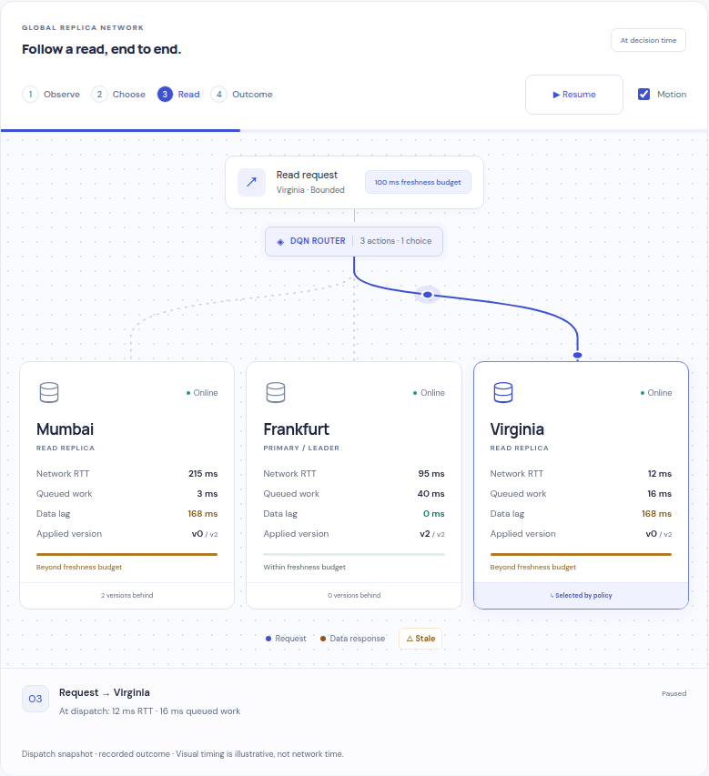

# Following a read through the system

The web laboratory turns a real routing decision into a finite visual walkthrough. Press **Animate read** to inspect one decision, or **Play** to follow the captured episode. In the live laboratory, each actual simulator step starts a walkthrough of that new decision.

## What the motion means

| Stage | Visual | Data source |
| --- | --- | --- |
| Observe | Client region, request class, freshness budget, and deadline | Observation available before acting |
| Choose | Policy hub and the selected replica's route | Executed action and recorded learned Q-values |
| Read | Blue request packet, service indicator, and a possible return packet | Selected action, dispatch telemetry, and recorded transport outcome |
| Outcome | Fresh/stale/failed status, measured response, and reward narration | Actual recorded outcome and reward terms |

A successful read returns a green packet when it meets the freshness budget, or an amber packet when its data is stale. Offline and timed-out reads have no return packet; the narration explains the failure. Labels and symbols accompany the colors. The replica gauges compare observed timestamp lag with the request's budget, capped at a full gauge when exceeded.

Animation timing is illustrative. The measured latency remains the recorded number of milliseconds, regardless of playback speed. All recorded outcome metrics are available immediately, including while paused. The walkthrough neither changes the simulator nor requests another action. Live inference uses frozen RL weights; observing a reward in this view does not retrain the agent.

Q-value bars compare estimated returns within the current observation. They are not probabilities or measured alternatives. Use the live snapshot branches to measure alternative outcomes from identical simulator and random state.

## Presentation controls

- **Animate read / Pause motion / Resume:** inspect the current read without advancing it. Pausing motion also stops automatic replay or live advancement.
- **0.5× Explain / 1× Follow / 4× Scan:** nominal walkthrough durations of 6.4, 3.2, and 0.8 seconds. Live automatic reads use the 3.2-second presentation interval plus inference time.
- **Previous / Next / seek / filters:** inspect another actual decision. The preceding walkthrough is canceled. Captured replay opens with a static recorded outcome.
- **Motion:** disable routing motion while retaining all information. A system reduced-motion preference disables the engine and updates immediately when the preference changes.
- **Show next state:** display the next observation without moving packets. The highlighted route still identifies the preceding action, as stated in the caption.

## Engine and cost

The application imports only `animate` from [`motion/mini`](https://motion.dev/docs/animate), pinned to Motion **14.6.0**, under its [MIT license](../web/public/motion-license.txt). The browser runs finite transform and opacity animations. SVG paths are native elements, with packet positions sampled from the selected path. There is one active walkthrough, cleaned up on replacement or unmount, and no continuous background traffic or graph-physics loop.

An isolated minified ES2022 browser bundle exporting this entry point measured **8,444 bytes raw / 3,349 bytes gzip** using the lockfile's esbuild and Node gzip. The motion extension grew the production JavaScript bundle from **77.86 kB to 83.44 kB gzip**, including the engine and its UI logic. After the final trace-validation and session-cleanup fixes, the complete bundle is **83.54 kB gzip**; CSS remains **9.33 kB gzip**. These are build measurements, not a frame-rate or low-end-device benchmark. Fonts, replay data, and the license notice are local assets.

The implementation is in [Topology.tsx](../web/src/Topology.tsx), [read-motion.ts](../web/src/read-motion.ts), and [topology.css](../web/src/topology.css). Browser checks in [routing-motion.spec.ts](../web/e2e/routing-motion.spec.ts) exercise real recorded trajectories, stale and failed responses, pause/resume, interrupted playback, seeking, and reduced motion. See the [verification record](validation.md).
